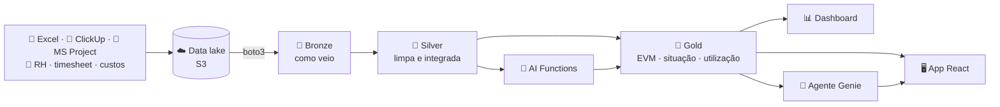
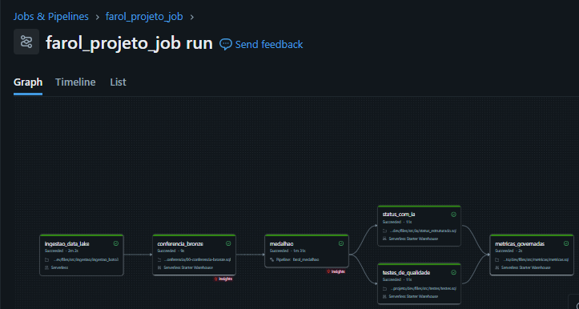
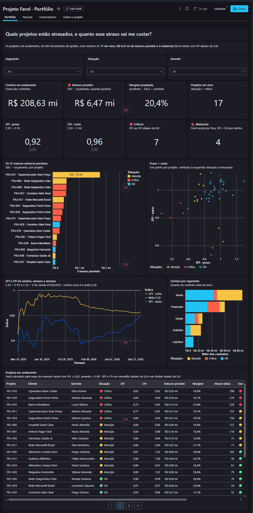
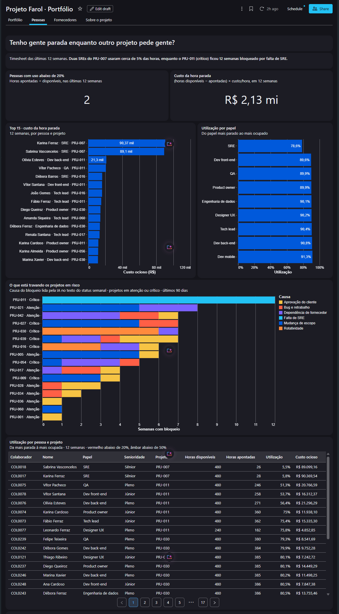
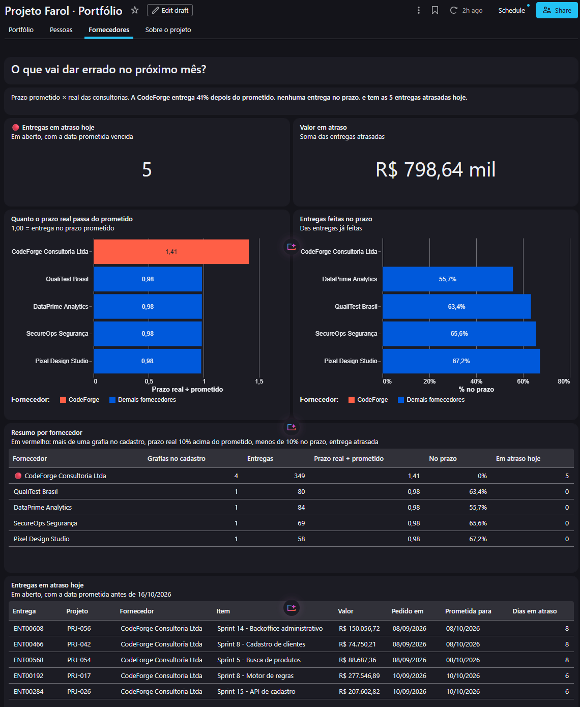
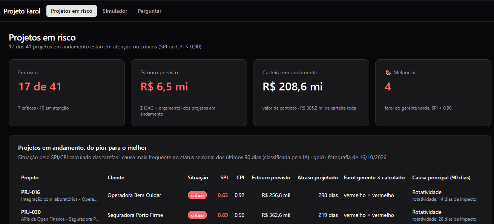

<h1 align="center">🚦 Projeto Farol</h1>

<p align="center">
  <b>Torre de Controle de projetos no Databricks</b><br>
  60 projetos em 3 ferramentas diferentes → 1 fonte da verdade, do data lake ao agente de IA.
</p>

<p align="center">
  
  
  
  
  
  
</p>

> **🇺🇸 In short:** end-to-end data platform on Databricks that integrates Excel, ClickUp and MS Project data
> into a medallion architecture, computes Earned Value metrics (SPI, CPI, EAC), reads free-text status with
> AI Functions and serves it through a dashboard, a React app and an AI agent. Infrastructure as code,
> 5 layers of data quality, ~4 min end to end.

<p align="center">
  
</p>

## 🎯 O problema

Uma empresa com **60 projetos e R$ 305 mi de carteira**, onde cada gerente usa uma ferramenta
(**20 em Excel, 25 no ClickUp, 15 no MS Project**) e pinta o próprio farol. Ninguém sabe responder:
**quais projetos estão atrasados, quanto isso vai custar, se há gente parada enquanto outro projeto pede
gente, e o que vai dar errado no próximo mês.**

## 📊 Resultados

<table>
<tr>
<td align="center"><h3>4.917</h3>tarefas de 3 ferramentas<br>num modelo só</td>
<td align="center"><h3>17 de 41</h3>projetos em andamento<br>em risco</td>
<td align="center"><h3>R$ 6,47 mi</h3>de estouro previsto<br>identificado</td>
<td align="center"><h3>4 🍉</h3>"melancias": verdes no status,<br>vermelhas no número</td>
</tr>
<tr>
<td align="center"><h3>R$ 0</h3>perdidos na limpeza<br>de 18 tipos de sujeira</td>
<td align="center"><h3>163</h3>status semanais<br>classificados por IA</td>
<td align="center"><h3>20/20</h3>no benchmark<br>do agente de IA</td>
<td align="center"><h3>~4 min</h3>pipeline de ponta a ponta,<br>toda segunda às 6h</td>
</tr>
</table>

**O que os dados revelaram:** 2 SREs com ~5% de uso enquanto um projeto crítico ficou 12 semanas travado por
falta de SRE · todas as entregas atrasadas vinham de um único fornecedor, cadastrado com 4 grafias diferentes ·
4 projetos reportados como verdes estavam, nos números, em atraso.

## 🏗️ Arquitetura



Um job semanal com 6 tarefas orquestra tudo: **ingestão → conferência → pipeline medalhão → testes ‖ IA → métricas**.
Job, pipeline, dashboard e agente são **código** (Declarative Automation Bundles) e sobem com `databricks bundle deploy`.

<p align="center"></p>

## 🖥️ Produtos de dados

<p align="center"></p>

<details>
<summary><b>Ver as outras telas</b> (dashboard de pessoas e fornecedores, app e simulador)</summary>
<br>

| Dashboard · Pessoas | Dashboard · Fornecedores |
|---|---|
|  |  |

**App · Projetos em risco** (farol do gerente × farol calculado, com as 🍉 em destaque)


**App · Simulador de realocação** (vale a pena mover uma pessoa ociosa para um projeto travado?)


</details>

## ✨ Destaques técnicos

- **Integração de fontes heterogêneas:** 3 formatos (planilha, JSON aninhado, XML) viram uma tabela só, com views de mesmo schema e `UNION ALL`.
- **Limpeza sem perda:** 18 tipos de sujeira tratados e catalogados; o custo total da bronze é igual ao da silver, centavo por centavo.
- **Gestão por Valor Agregado (EVM):** PV, EV, AC, SPI, CPI e EAC por projeto e por semana, calculados das tarefas e não do farol do gerente.
- **IA generativa com custo sob controle:** `ai_classify` e `ai_extract` só onde agregam valor, com `MERGE` incremental.
- **Governança:** Unity Catalog, metric view como fonte única dos KPIs, chaves fora do Git e agente consultando em nome do usuário.

## 📚 Documentação

| | |
|---|---|
| [Arquitetura](docs/arquitetura.md) | Diagramas completos e o que cada tarefa do job faz |
| [Decisões e aprendizados](docs/decisoes-e-aprendizados.md) | Por que cada escolha técnica, e os problemas reais resolvidos no caminho |
| [Catálogo de sujeiras](docs/sujeiras.md) | Os 18 tipos de sujeira dos dados brutos e o tratamento de cada um |
| [Qualidade de dados](tests/README.md) | As 5 camadas de teste, da ingestão à resposta do agente |
| [Dados de exemplo](dados_exemplo/README.md) | Um arquivo bruto de cada ferramenta, para ver o problema de perto |
| [App](minha-torre/README.md) | As telas do app e como publicar |

<details>
<summary><b>🛠️ Stack</b></summary>
<br>

| Camada | Tecnologias |
|---|---|
| Ingestão | Python, `boto3` (S3), `read_files` |
| Armazenamento e governança | Delta Lake, Unity Catalog |
| Transformação | SQL, Lakeflow Spark Declarative Pipelines (materialized views + expectations), serverless |
| Orquestração | Databricks Jobs |
| IA | AI Functions (`ai_classify`, `ai_extract`), Genie, metric views |
| Visualização e app | AI/BI Dashboards, Databricks Apps, React, TypeScript, Tailwind CSS |
| DevOps | Declarative Automation Bundles, Databricks CLI, Git |

</details>

<details>
<summary><b>🚀 Como executar</b></summary>
<br>

Pré-requisitos: workspace Databricks (funciona no Free Edition), Databricks CLI v0.250+, Python 3 e um bucket S3 com os arquivos brutos.

```bash
# 1 · login
databricks auth login --host https://<seu-workspace>.cloud.databricks.com --profile DEFAULT

# 2 · no SQL Editor: catálogo farol_projeto, schemas bronze/silver/gold e o volume bronze.raw

# 3 · chaves do data lake, FORA do Git
mkdir -p .databricks/bundle/dev
echo '{"s3_access_key_id":"...","s3_secret_access_key":"..."}' > .databricks/bundle/dev/variable-overrides.json

# 4 · deploy e execução (o agente precisa das tabelas: deploy → run → deploy)
databricks bundle deploy --profile DEFAULT --var="warehouse_id=<seu-warehouse>" --var="s3_endpoint=<endpoint-s3>"
databricks bundle run farol_projeto_job --profile DEFAULT
databricks bundle deploy --profile DEFAULT

# 5 · conferência: 19 linhas, todas "ok"
python scripts/run_sql.py tests/verificacao-final.sql --profile DEFAULT
```

</details>

<details>
<summary><b>🤖 Como foi construído</b></summary>
<br>

Com desenvolvimento assistido por IA ([Claude Code](https://claude.com/claude-code)), em etapas incrementais:
cada camada só começava depois do deploy da anterior e da conferência dos números de referência.
O [`CLAUDE.md`](CLAUDE.md) é o contexto que guia a IA: regras de negócio, modelo de dados, convenções e armadilhas resolvidas.

**Próximos passos:** modelo de ML para prever estouro em 30 dias · CI no GitHub Actions · fluxo de aprovação no app · alertas automáticos.

</details>

---

<p align="center">
  <b>Jéssica Fuentes</b> · Analista de Dados / Engenharia de Dados<br>
  <a href="https://www.linkedin.com/in/j%C3%A9ssica-fuentes/">LinkedIn</a> ·
  <a href="https://github.com/Jessica-Fuentess">GitHub</a>
</p>
