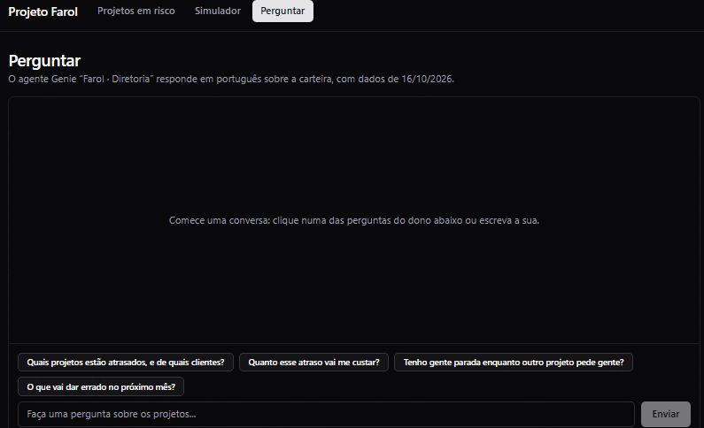
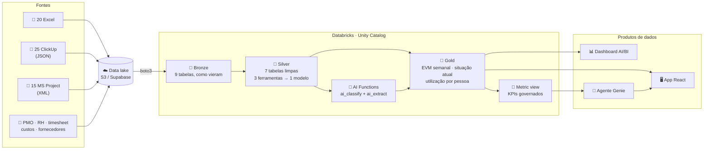
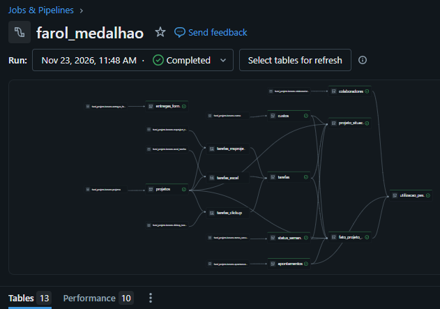
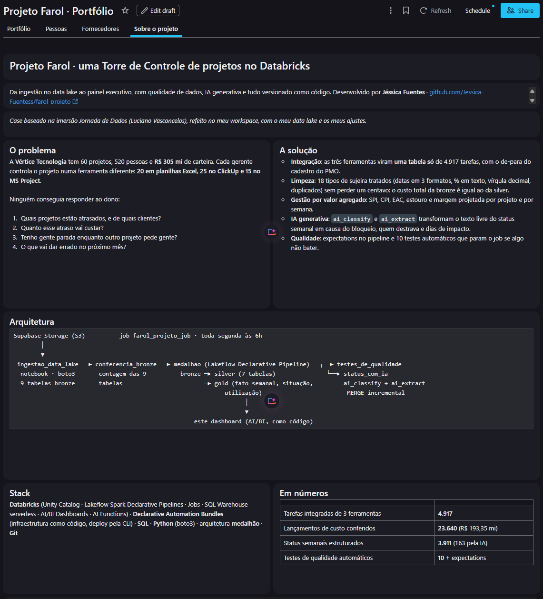
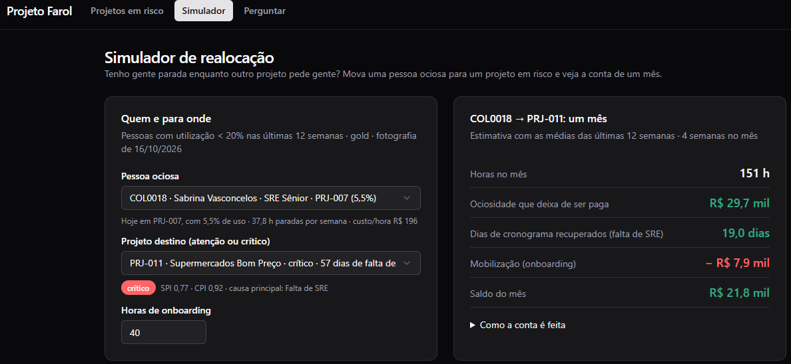
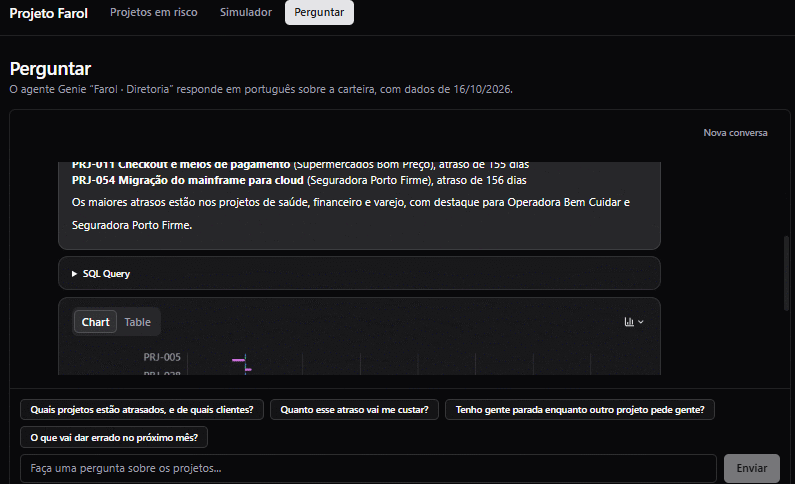

<h1 align="center">🚦 Projeto Farol</h1>

<p align="center">
  <b>Torre de Controle de projetos no Databricks</b><br>
  60 projetos, 3 ferramentas de gestão diferentes, 1 fonte da verdade: do data lake ao agente de IA.
</p>

<p align="center">
  
  
  
  
  
  
  
</p>

<p align="center">
  <a href="#-o-problema">Problema</a> ·
  <a href="#-resultados">Resultados</a> ·
  <a href="#%EF%B8%8F-arquitetura">Arquitetura</a> ·
  <a href="#%EF%B8%8F-produtos-de-dados">Produtos</a> ·
  <a href="#-destaques-técnicos">Destaques</a> ·
  <a href="#-qualidade-de-dados">Qualidade</a> ·
  <a href="#-como-executar">Como executar</a>
</p>

> **🇺🇸 In short:** an end-to-end data platform on **Databricks** that integrates project data from
> **Excel, ClickUp and MS Project** (60 projects, 3 formats, 18 data-quality issues) into a
> **medallion architecture** (Lakeflow Declarative Pipelines, Unity Catalog). It computes Earned Value
> metrics (SPI, CPI, EAC), classifies free-text status reports with **AI Functions**, and serves the results
> through an **AI/BI dashboard**, a **React web app** and a **Genie AI agent** (20/20 on its benchmark).
> Everything is **infrastructure as code** (Declarative Automation Bundles), tested in 5 layers and
> runs end to end in **~4 minutes** every Monday.

<p align="center">
  
</p>

---

## 🎯 O problema

A **Vértice Tecnologia** (empresa fictícia) tem **60 projetos, 520 pessoas e R$ 305 mi de carteira**.
Cada gerente controla o projeto do seu jeito: **20 em planilhas Excel, 25 no ClickUp e 15 no MS Project**.
Cada ferramenta tem seu formato, e cada gerente pinta o próprio farol. Ninguém consegue responder:

| # | Pergunta do dono | Como o Farol responde |
|---|---|---|
| 1 | Quais projetos estão atrasados, e de quais clientes? | SPI e CPI calculados das tarefas, não do farol do gerente |
| 2 | Quanto esse atraso vai me custar? | EAC, estouro previsto e margem projetada |
| 3 | Tenho gente parada enquanto outro projeto pede gente? | Utilização do timesheet × causa do bloqueio lida por IA |
| 4 | O que vai dar errado no próximo mês? | Entregas de fornecedores atrasadas e janelas de congelamento |

## 📊 Resultados

<table>
<tr>
<td align="center"><h3>4.917</h3>tarefas de 3 ferramentas<br>num modelo só</td>
<td align="center"><h3>17 de 41</h3>projetos em andamento<br>em risco</td>
<td align="center"><h3>R$ 6,47 mi</h3>de estouro previsto<br>identificado</td>
<td align="center"><h3>4 🍉</h3>"melancias": verdes no status,<br>vermelhas no número</td>
</tr>
<tr>
<td align="center"><h3>R$ 0</h3>perdidos na limpeza<br>(R$ 193,35 mi = R$ 193,35 mi)</td>
<td align="center"><h3>163</h3>status semanais<br>classificados por IA</td>
<td align="center"><h3>20/20</h3>no benchmark<br>do agente de IA</td>
<td align="center"><h3>~4 min</h3>pipeline de ponta a ponta,<br>toda segunda às 6h</td>
</tr>
</table>

**Exemplos do que os dados revelaram:**
- **2 SREs com ~5% de uso** no PRJ-007, enquanto o PRJ-011 (crítico) ficou **12 semanas travado por falta de SRE**.
  O simulador mostra que mover uma delas recupera **19 dias de cronograma** e economiza **R$ 21,8 mil no mês**.
- **Todas as 5 entregas atrasadas** vêm de um único fornecedor, cadastrado com **4 grafias diferentes**,
  que entrega **41% depois do prazo** e tem **0% de entregas no prazo**.
- **4 projetos "melancia"**: o gerente reporta verde, mas o SPI está abaixo de 0,9.

## 🏗️ Arquitetura



**Orquestração** · o job `farol_projeto_job` roda toda segunda às 6h, com 6 tarefas:

<p align="center"></p>

| Tarefa | Tipo | O que faz |
|---|---|---|
| `ingestao_data_lake` | Notebook (Python, boto3) | Baixa os arquivos do data lake, pousa num volume e cria as 9 tabelas bronze com `read_files` |
| `conferencia_bronze` | SQL | Confere a contagem das 9 tabelas; se divergir, o job para antes de transformar |
| `medalhao` | Pipeline Lakeflow | Silver (limpeza e integração) e gold (EVM, situação, utilização) com expectations |
| `testes_de_qualidade` | SQL | 10 testes de regra de negócio entre as camadas |
| `status_com_ia` | SQL + AI Functions | Lê o texto livre do status e extrai causa do bloqueio, quem destrava e dias de impacto |
| `metricas_governadas` | SQL | Publica a metric view com a fórmula única de cada KPI |

<p align="center"></p>

Mais detalhes em [`docs/arquitetura.md`](docs/arquitetura.md).

## 🖥️ Produtos de dados

### Dashboard AI/BI · 4 páginas, uma pergunta do dono em cada

<table>
<tr>
<td width="50%"><b>Portfólio</b>: atrasos, estouro e melancias<br></td>
<td width="50%"><b>Pessoas</b>: gente parada × o que trava os projetos<br></td>
</tr>
<tr>
<td width="50%"><b>Fornecedores</b>: prazo prometido × real<br></td>
<td width="50%"><b>Sobre o projeto</b>: problema, solução e arquitetura<br></td>
</tr>
</table>

### App web · React + TypeScript (Databricks Apps)

| Tela | Para que serve |
|---|---|
| **Projetos em risco** | Ranking do pior para o melhor, com o farol do gerente ao lado do farol calculado e as 🍉 em destaque |
| **Simulador de realocação** | Vale a pena mover uma pessoa ociosa para um projeto travado? Horas, ociosidade evitada, dias recuperados, custo de onboarding e saldo do mês |
| **Perguntar** | Chat com o agente de IA, em português, mostrando o SQL de cada resposta |

<p align="center"></p>
<p align="center"></p>

### Agente de IA · Genie "Farol · Diretoria"

O dono pergunta em português, o agente responde com dados da gold e mostra o SQL usado.
Ele foi instruído com as regras de negócio (cortes de SPI/CPI, melancia, janelas de congelamento) e validado
com um **benchmark de 20 perguntas com resposta conhecida: 20/20**.

<p align="center"></p>

## ✨ Destaques técnicos

- **Integração de fontes heterogêneas.** Excel (datas em 3 formatos, % como texto, linha de TOTAL), ClickUp
  (datas em milissegundos, campos aninhados em `custom_fields`) e MS Project (tarefas-resumo, horas em
  `PT40H0M0S`) viram **uma tabela só**, com três views temporárias de mesmo schema e um `UNION ALL`.
- **18 tipos de sujeira tratados sem perder dado.** Cada um catalogado em [`docs/sujeiras.md`](docs/sujeiras.md),
  com a coluna afetada e o tratamento. Valor com vírgula decimal é convertido com `replace` antes do `CAST`:
  um `try_cast` teria apagado **R$ 5,4 mi em silêncio**.
- **Gestão por Valor Agregado (EVM).** PV, EV e AC acumulados por semana; SPI, CPI, EAC, estouro e margem por
  projeto. Razões da carteira sempre como `SUM/SUM`, nunca a média das razões.
- **IA generativa com custo sob controle.** `ai_classify` e `ai_extract` (com JSON schema tipado) só nos 163 textos
  em que ela agrega valor; regra e palavra-chave no resto; `MERGE` incremental para nunca reclassificar.
- **Métricas governadas.** Uma metric view no Unity Catalog é a fonte única das fórmulas para o dashboard e o agente.
- **Infraestrutura como código.** Job, pipeline, dashboard e agente são recursos de um
  **Declarative Automation Bundle** e sobem com `databricks bundle deploy`. O dashboard e o agente são **gerados
  por scripts Python** a partir do código, não clicados na interface.
- **Segurança.** Chaves do data lake fora do Git (variáveis do bundle); o agente consulta **em nome do usuário**
  (OAuth on-behalf-of), respeitando as permissões do Unity Catalog; o app tem só leitura na silver e na gold.

## ✅ Qualidade de dados

Cinco camadas, da entrada à resposta do agente. Detalhes em [`tests/README.md`](tests/README.md).

```
1. Conferência da bronze      → as 9 tabelas chegaram inteiras?           (para o job se não)
2. Expectations no pipeline   → datas, faróis, %, horas e chaves válidas  (FAIL UPDATE)
3. 10 testes de negócio       → horas = TOTAL, custo bronze = silver, EV bate entre fontes...
4. Verificação final          → 19 números de negócio conferidos do bronze à gold
5. Benchmark do agente        → 20 perguntas com resposta conhecida: 20/20
```

## 🧠 Decisões e aprendizados

O porquê de cada escolha de arquitetura e os problemas reais que apareceram no caminho (com causa e solução)
estão em [`docs/decisoes-e-aprendizados.md`](docs/decisoes-e-aprendizados.md). Alguns exemplos:

- O warehouse devolve booleanos como texto, e `"false"` é verdadeiro em JavaScript: o app marcava **todos** os
  projetos como melancia até a comparação ficar explícita.
- O escopo OAuth do agente mudou de nome (`dashboards.genie` → `genie`), e a autorização antiga ficava em cache.
- A ingestão falhava "do nada": o data lake (plano gratuito) tinha sido pausado por inatividade.

## 🛠️ Stack

| Camada | Tecnologias |
|---|---|
| Ingestão | Python, `boto3` (protocolo S3), Supabase Storage, `read_files` |
| Armazenamento e governança | Delta Lake, Unity Catalog (catálogo, schemas, volume, grants) |
| Transformação | SQL, Lakeflow Spark Declarative Pipelines (materialized views + expectations), serverless |
| Orquestração | Databricks Jobs (agendamento semanal, dependências, execução paralela) |
| IA | Databricks AI Functions (`ai_classify`, `ai_extract`), Genie, metric views |
| Visualização | AI/BI Dashboards (gerados por Python) |
| Aplicação | Databricks Apps, AppKit, React 19, TypeScript, Tailwind CSS, Zod |
| DevOps | Declarative Automation Bundles, Databricks CLI, Git |

## 📁 Estrutura do repositório

```
farol_projeto/
├── databricks.yml              # o bundle: variáveis, targets e o que sobe no deploy
├── resources/                  # job, pipeline, dashboard e agente como código
├── src/
│   ├── ingestao/               # data lake (S3) → volume → 9 tabelas bronze
│   ├── conferencia/            # confere a bronze antes de transformar
│   ├── silver/                 # limpeza e integração: 3 ferramentas → 1 modelo
│   ├── gold/                   # EVM (PV, EV, AC, SPI, CPI, EAC), situação e utilização
│   ├── testes/                 # 10 testes de qualidade
│   ├── ia/                     # ai_classify + ai_extract no texto do status
│   └── metricas/               # metric view com os KPIs governados
├── minha-torre/                # app web (React + TypeScript + AppKit)
├── scripts/                    # geradores do dashboard e do agente, grants e utilitários
├── tests/                      # verificação final (19 números) e benchmark do agente
├── dados_exemplo/              # um arquivo bruto de cada ferramenta, para ver o problema
├── docs/                       # arquitetura, decisões, catálogo de sujeiras e imagens
└── CLAUDE.md                   # contexto do projeto para desenvolvimento assistido por IA
```

## 🚀 Como executar

**Pré-requisitos:** workspace Databricks (funciona no Free Edition), [Databricks CLI](https://docs.databricks.com/dev-tools/cli/install.html)
v0.250+, Python 3, Node.js 22+ (só para o app) e um bucket compatível com S3 com os arquivos brutos.

```bash
# 1 · login
databricks auth login --host https://<seu-workspace>.cloud.databricks.com --profile DEFAULT

# 2 · catálogo, schemas e volume (no SQL Editor)
#   CREATE CATALOG farol_projeto;
#   CREATE SCHEMA farol_projeto.bronze; CREATE SCHEMA farol_projeto.silver; CREATE SCHEMA farol_projeto.gold;
#   CREATE VOLUME farol_projeto.bronze.raw;

# 3 · chaves do data lake, FORA do Git
mkdir -p .databricks/bundle/dev
echo '{"s3_access_key_id":"...","s3_secret_access_key":"..."}' > .databricks/bundle/dev/variable-overrides.json

# 4 · deploy e execução (o agente precisa das tabelas: deploy → run → deploy)
databricks bundle deploy --profile DEFAULT \
  --var="warehouse_id=<seu-warehouse>" --var="s3_endpoint=<endpoint-s3>"
databricks bundle run farol_projeto_job --profile DEFAULT
databricks bundle deploy --profile DEFAULT

# 5 · conferência: 19 linhas, todas "ok"
python scripts/run_sql.py tests/verificacao-final.sql --profile DEFAULT
```

O passo a passo do app está em [`minha-torre/README.md`](minha-torre/README.md).

## 🤖 Como foi construído

O projeto foi desenvolvido com **desenvolvimento assistido por IA** ([Claude Code](https://claude.com/claude-code)),
em etapas incrementais: cada camada (silver, gold, IA, dashboard, app, agente) só começava depois do deploy da
anterior e da conferência dos números de referência. O [`CLAUDE.md`](CLAUDE.md) é o contexto que guia a IA:
regras de negócio, modelo de dados, convenções e as armadilhas já resolvidas.

## 🔭 Próximos passos

- [ ] Modelo de ML que prevê a probabilidade de estouro em 30 dias (o app já tem a rota preparada para o score)
- [ ] CI no GitHub Actions: `bundle validate`, typecheck e lint do app a cada push
- [ ] Fluxo de aprovação no app (realocar pessoa → decisão registrada com quem aprovou)
- [ ] Alertas automáticos quando um projeto vira crítico ou melancia

---

<p align="center">
  Case e dataset sintético da imersão <b>Jornada de Dados</b> (Luciano Vasconcelos), implementado e adaptado por mim.<br><br>
  <b>Jéssica Fuentes</b> · Analista de Dados / Engenharia de Dados<br>
  <a href="https://www.linkedin.com/in/j%C3%A9ssica-fuentes/">LinkedIn</a> ·
  <a href="https://github.com/Jessica-Fuentess">GitHub</a>
</p>
