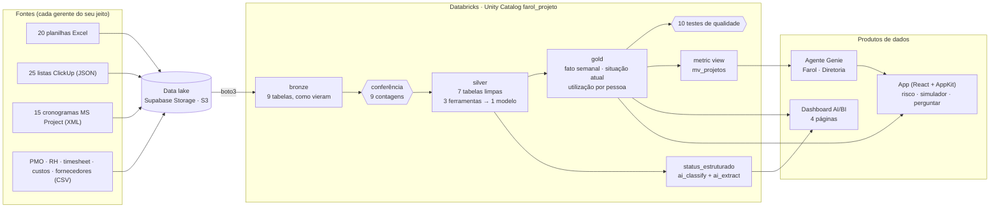
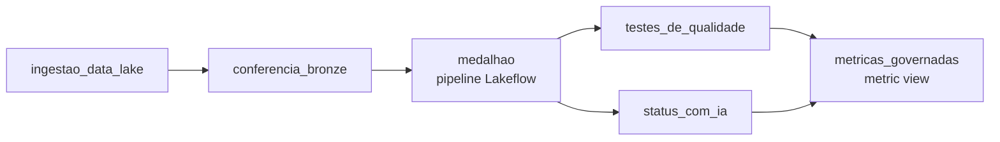

# Arquitetura

## O job `farol_projeto_job` (toda segunda, 6h · ~4 min de ponta a ponta)

Tudo é código, publicado com `databricks bundle deploy` (Declarative Automation Bundles):
o job, o pipeline, o dashboard, o Genie e o app.
